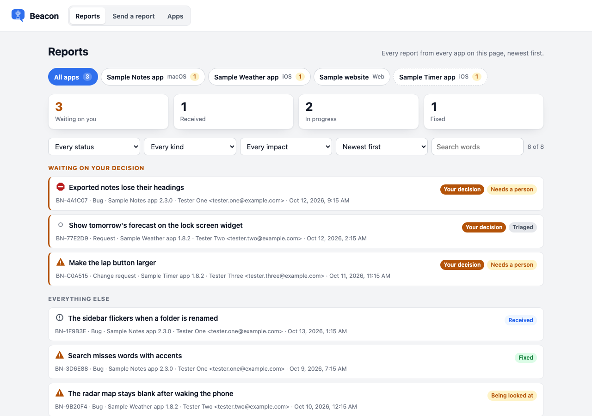
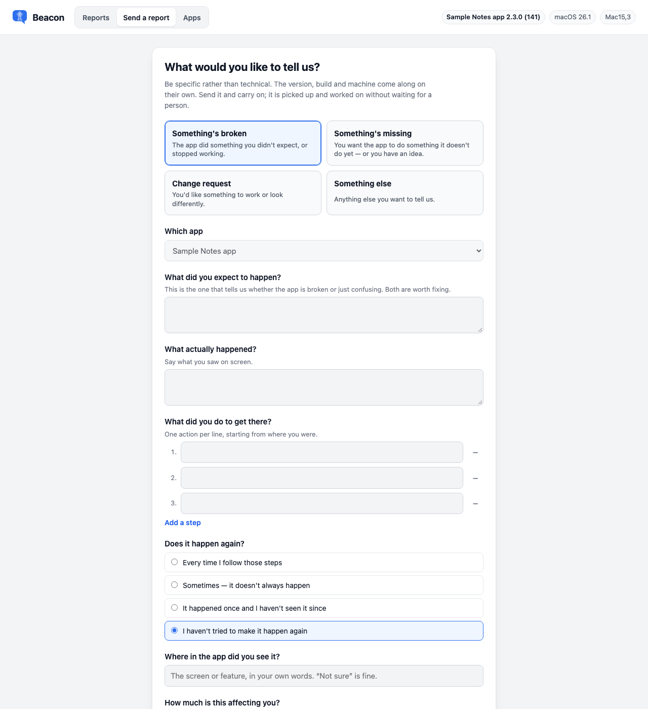

# The Beacon page

*Last updated: 2026-10-13*

`Inbox/index.html` is the Beacon page: a single-file Claude artifact. It stores reports in the artifact's own database, and a Claude session picks them up. One page serves every app the owner adds. A bar at the top switches between its three views:

| View | What it is |
|---|---|
| **Reports** | [The dashboard](../docs/the-board.md): every report from every app, a tab per app, counts of what waits on the owner, and Approve and Cancel, as a list or as a board with Backlog, Inbox, Triaged, To do, In progress, Done and Deployed columns. Your changes reach the GitHub issues at the next daily run. The page opens here. |
| **Send a report** | The report form testers fill in. A link from the Beacon button inside an app opens here, with the app chosen. |
| **Apps** | The app list: add, change and remove apps, with no database editing and no republish. |

Which view a link opens: `view=form` opens the form and `view=board` the dashboard. Otherwise a link that carries `app` together with any detail only an app puts in the link (`version`, `build`, `bundle`, `commit`, `repo`, `os`, `osVersion`, `device` or `arch`) opens the form, and every other link, the plain page link included, opens the dashboard.

## Publish your own copy

Each team that adopts Beacon publishes its own copy of this file into its own Claude organization. The page belongs to whoever published it. The steps are in [Setup: the Claude-only path](../docs/setup-claude-only.md).

## Change the page

1. Edit `Inbox/index.html` in this repository.
2. Republish the file to the same page.

Never edit the live page by hand. This file is the one source, and the next republish overwrites any hand edit. Adding or changing an app needs no republish: it is done in the page's **Apps** view, and the page reads its app list from the database.

After a change that shows on screen, retake the documentation's screenshots with `Scripts/page-screenshots/take.sh`. The [developer guide](../internal/DEVELOPER-GUIDE.md#screenshots-of-the-page) describes it.

## Change the completeness rules

The page carries a JavaScript copy of the rules that refuse empty answers: the minimum length, the list of placeholder answers, and the messages. The Swift original is `CompletenessRules` in `Sources/BeaconCore/Completeness.swift`.

1. Change `Sources/BeaconCore/Completeness.swift` first, and run its tests in `Tests/BeaconCoreTests/CompletenessTests.swift`.
2. Copy the same change into `Inbox/index.html`, keeping the values and messages identical.
3. Republish the page.

No test compares the two copies, so check them against each other by hand.

## The words the page copies

The page keeps its own copies of words that live elsewhere, because it is one file with no build step. Change the original first, then the copy here.

| What | Original | Copy in `Inbox/index.html` |
|---|---|---|
| The completeness rules and their messages | `CompletenessRules` in `Sources/BeaconCore/Completeness.swift` | `MIN_CHARS`, `PLACEHOLDERS` and the messages in `check()` |
| Kind titles and blurbs | `FeedbackKind.title` and `.blurb` in `Sources/BeaconCore/Report.swift` (copied for the web in `KIND_WORDS` in `Web/src/wording.ts`) | `KIND_WORDS` |
| Impact answers and their order | `Impact.question` and `.rank` in `Sources/BeaconCore/Report.swift` (`IMPACT_WORDS` in `Web/src/wording.ts`) | `IMPACT`, `IMPACT_RANK` |
| Reproducibility answers | `Reproducibility.question` in `Sources/BeaconCore/Report.swift` (`REPRODUCIBILITY_WORDS` in `Web/src/wording.ts`) | `REPRO` |
| Field labels and hints | `Sources/BeaconUI/FormSteps.swift` (`FIELD_LABELS` and `FIELD_HINTS` in `Web/src/wording.ts`) | `FIELD_LABELS`, `FIELD_HINTS` |
| The area question per kind | `AreaPicker` titles in `Sources/BeaconUI/FormSteps.swift` | `AREA_LABELS` |
| "Anything to show us?", "Before this can go", "Sent — thank you", "Your reference" | `UI` in `Web/src/wording.ts`, `Sources/BeaconUI/BeaconSheet.swift` and `FormSteps.swift` | The page's HTML |
| Status names on the dashboard | The table in `docs/how-it-works.md` | `STATUS` |
| Beacon's mark | `Brand/beacon-mark.svg` | The `<svg>` in the page's header |

Where the web sheet says "the page", the page says "the app", as the Mac and iPhone sheet does: the page is opened from inside an app. The query keys the page reads are a separate contract. `everyKeyIsOneThePageReads` in `Tests/BeaconCoreTests/InboxLinkTests.swift` compares the Swift keys with a list copied from the page, so update that list when the page's keys change.

## How the page works inside

The storage layout, the doorbell, the query keys and the page's views are in the [developer guide](../internal/DEVELOPER-GUIDE.md).
