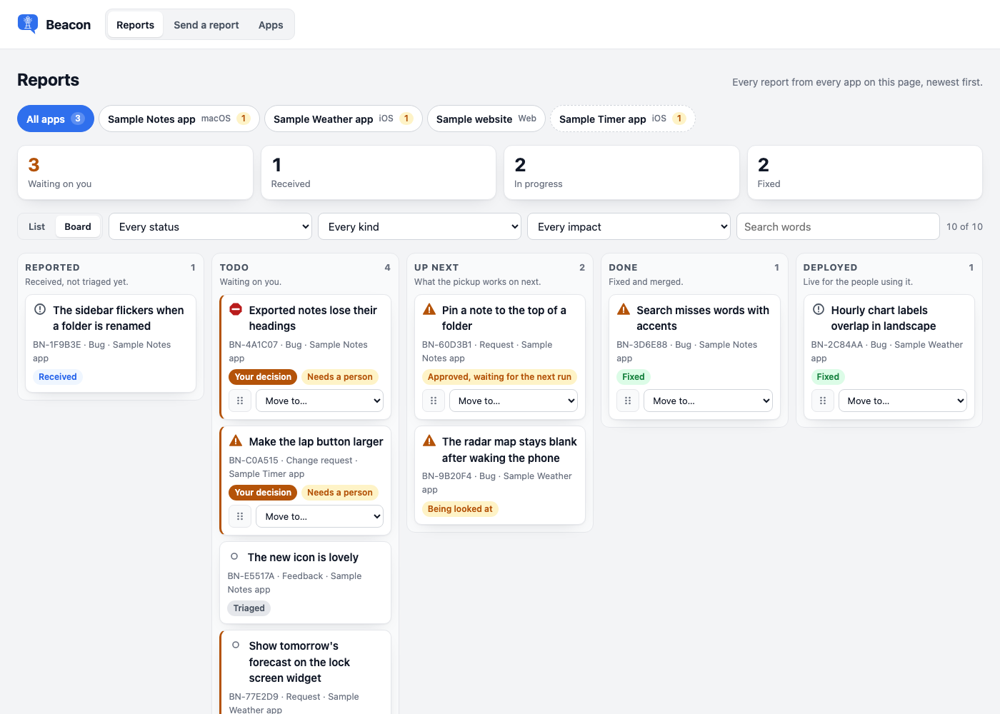
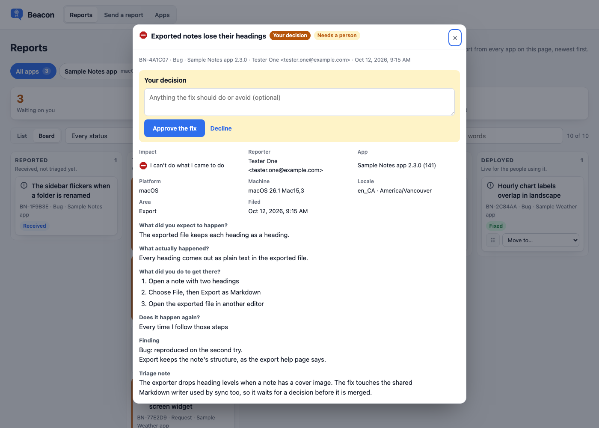
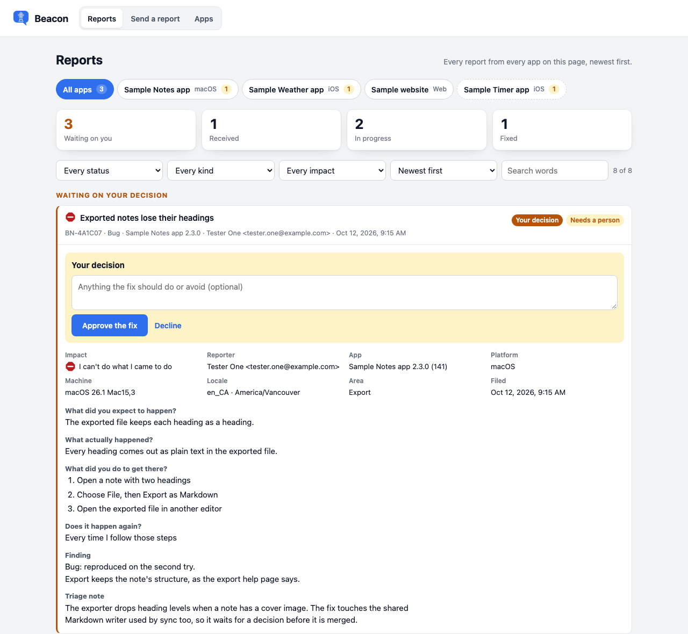
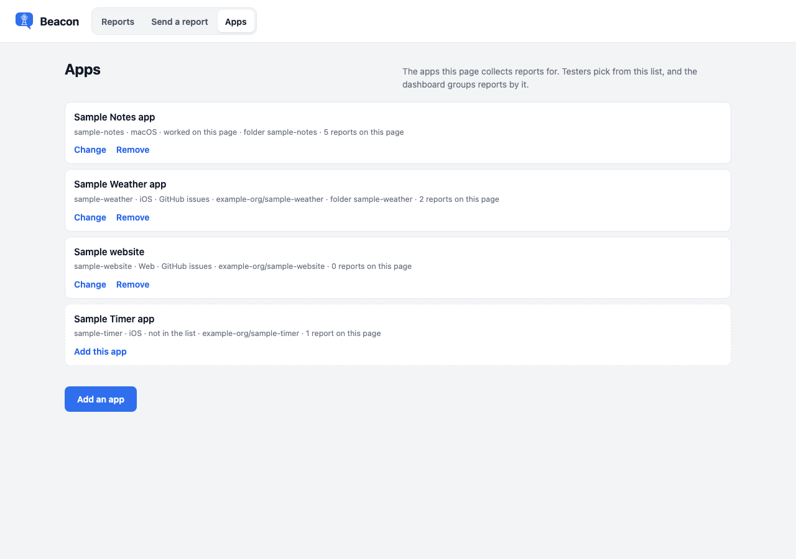
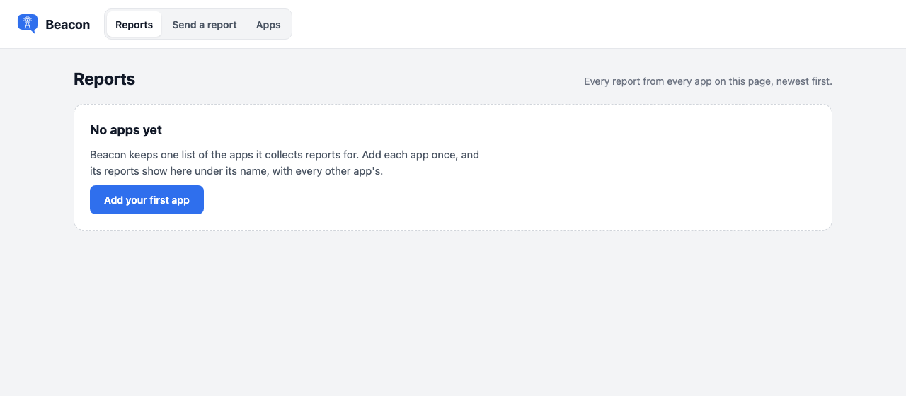

# The dashboard

*Last updated: 2026-10-13*

The dashboard is where the owner reads every report from every app on the Beacon page, and what happened to each. One page serves all your apps: each app has its own tab, with its own counts. The pickup writes the outcomes. The one thing you write is your decision on work that waits on a person.

## Open it

Open your Beacon page link. The page opens on the dashboard:

```text
https://claude.ai/code/artifact/…
```

The bar at the top of the page switches between three views:

| View | What it is |
|---|---|
| **Reports** | The dashboard. |
| **Send a report** | The report form testers fill in. |
| **Apps** | The list of apps the page collects reports for. See [Add and change apps](#add-and-change-apps). |

The switch works inside the page, so it works however the link was opened. A link from the Beacon button inside an app opens the form instead, because it carries the app's name and details. To send someone straight to the form from a plain link, add `?view=form`. `?view=board` opens the dashboard, as the plain link does.

The dashboard updates live, newest report first, and loads the latest 1,000. A long list or column shows 25 cards (50 rows in the list layout) and a **Show more** button for the next page; changing the app, a filter or the search starts over.


The dashboard, the Apps view and the form in these pictures show made-up sample apps and reports.

## Set up the dashboard from scratch

1. **Publish the page.** In Claude Code, in your Beacon checkout, ask Claude to publish `Inbox/index.html` as an artifact with the `db` and `artifact` capabilities. Keep the link. [Setup: the Claude-only path](setup-claude-only.md) step 2 has the exact request.
2. **Open the link.** The page opens on the dashboard. With no apps yet, it shows **No apps yet**.
3. **Add your first app.** Click **Add your first app**, fill in the name, platform and where its reports are worked, and click **Save the app**. The fields are under [Add and change apps](#add-and-change-apps).
4. **Share the page** with each tester, with edit access, from the page's share menu.
5. **Point the app at the page.** Put the Beacon button in the app with the page link ([Quickstart](quickstart.md) steps 1 to 3). The button opens the page's form with the app chosen and its version, build and device filled in.
6. **Send a test report** from the app, then click **Reports**. The report is on the dashboard under the app's tab.

Where each way of reporting sends people:

| How the tester reports | Where they go | Where the report lands |
|---|---|---|
| The Beacon button in a Mac or iPhone app (`BeaconInboxButton`) | This page's form, with the app chosen | This page. The pickup works it here, or files it as a GitHub issue when the app's reports are worked as GitHub issues. Either way it stays on the dashboard with its outcome. |
| The in-app report sheet (`BeaconSheet`) | A sheet inside the app | A GitHub issue in the app's repository, directly or through the [relay](setup-relay.md). It does not reach this page. |
| The web sheet on a website | A sheet on the site | A GitHub issue through the relay ([Setup: a website](setup-web.md)). It does not reach this page. |
| The page link, opened plainly | The dashboard. **Send a report** opens the form, where the tester picks the app. | This page. |

## Run several projects on one dashboard

One page serves every app. There is no page per project.

1. Add each app in the **Apps** view: one entry per app, each with its own short id. A Mac app and its iPhone version can be one app or two; two gives each its own tab.
2. Use the same page link in every app's Beacon button. The link from each app names the app, so its reports land under its own tab.
3. Choose, per app, where its reports are worked:
    - **On this page.** The pickup works the report on the page. The dashboard is the whole record.
    - **As GitHub issues.** The pickup files each page report as an issue in the app's repository, then writes the outcome back onto the report, so it shows on the dashboard like any other. Reports that the in-app or web sheet files straight to GitHub stay in GitHub; the app's tab says so and links to its issues.
4. Read everything under **All apps**, or one app at a time with its tab. Each tab's number counts that app's reports waiting on your decision, and the four counts follow the tab you choose.

The pickup reads the same app list, so it knows each app's repository, folder and where its reports are worked. Adding an app needs no republish and no change to the pickup.

## List or board

The **List** and **Board** switch beside the filters changes how the dashboard lays out the reports. The page remembers the choice on this browser. The tabs, counts and filters work the same in both.

- **List**: reports waiting on your decision first, then everything else, newest first or highest impact first.
- **Board**: one column per stage, left to right. Within a column, the highest impact comes first, then the oldest.



| Column | What is in it |
|---|---|
| **Inbox** | Received, not triaged yet. |
| **To Triage** | Triage read it and it is not going to To do. A flag can say why: needs more info, can't reproduce, confusing to users, or needs your decision. Feature and change requests and feedback wait here until you move them. |
| **Backlog** | Kept open, not being worked on now. You park a card here; moving it out puts it back where it was. |
| **To do** | Queued for the next run: bugs triage will fix on its own, and anything you approved. |
| **In progress** | Being worked on now. |
| **Done** | Fixed and merged to the main branch. |
| **Deployed** | The fix is live for the people using the app. |

Canceled and duplicate reports, and reports that work as designed, are not in a column. They are under **Closed**, below the board, folded away until you open it.

Click a card's title to open the whole report, the same detail a list row shows, Approve and Cancel included.



### Move a card

With a mouse, drag the card itself. With a finger, drag it by its grip, the dotted square at its foot, so a swipe anywhere else still scrolls. Or choose a column from its **Move to** menu, which works from the keyboard. Only people who can edit the page see the grip and the menu. Every card moves to every column, closed cards included.

| Where it lands | What it does |
|---|---|
| To do | Approves it, exactly as **Approve the fix** or **Approve building it** does, unless it is already approved or being worked. The next pickup works it. Feedback can go here too: the pickup acts on it. |
| Out of To do, before work starts | Withdraws your approval and puts back the status it had. |
| Canceled: not doing, or Canceled: duplicate | Cancels it, with the reason. The next run closes the issue and says why. These are in the **Move to** menu and as the **Cancel** buttons on an opened report; they are not columns. |
| Any other column | Moves the card and nothing else. The pickup leaves a card where you put it; the only cards it moves are the ones it triages out of Inbox (into To Triage for you, or To do for bugs it fixes) and the ones it finishes (into Done). |
| Back from Closed | Reopens it as triaged, in the column you chose. |

## Choose an app

The tabs under the heading are **All apps**, then one tab per app in the app list, with its platform: macOS, iOS, Web or Other. A number on a tab counts that app's reports waiting on your decision. The page remembers the tab you chose on this browser. A link with `?app=<id or name>` and nothing else opens on that app's tab.

A report whose app is not in the app list still shows, under a tab with a dashed border named after the app on the report. This happens when an app is removed from the list, or when a report names an app the list never had. That tab offers **Add this app**, which opens the Apps view with the name, id, platform and repository filled in from the report.

An app whose reports are worked as GitHub issues sends nothing to this page from its in-app sheet or website. Its tab says so and links to its issues.

## Read the counts

Four counts sit under the tabs, for the selected app or for all apps:

| Count | Reports counted |
|---|---|
| **Waiting on you** | Reports that wait on your decision: the pickup stopped on them and nobody has approved or declined them. Feedback is never counted here. |
| **Received** | Sent, not yet picked up. |
| **In progress** | Filed, being looked at, or approved and waiting for the next run. |
| **Fixed** | Fixed, proven and merged. |

Click a count to show only those reports. Click it again to show everything.

The board has no Inbox column; Inbox reports show in the list.

## Attach images to a report

Under your note in Your changes, **Add images** attaches screenshots or mockups of your own. They show as thumbnails under the note, save as soon as you add them, and have an × to remove one. Click any thumbnail, yours or the reporter's, to see it full size; click again or press Escape to close. They are kept apart from the reporter's images, in the report's `ownerAttachments`, and the pickup reads them with your note.

## Waiting for human

Tick **Waiting for human** in Your changes to keep a report in To do without the pickup working on it, for example when it needs design work first. The pickup skips it until you untick the box. The flag shows as a chip on the card and in the Any flag filter.

## The Triage view

The third layout, **Triage**, is for working through what Claude has triaged. The To Triage column takes the left 60% of the page, one ticket open at a time (the top one when the page loads; opening another closes it) and the rest collapsed to a title and recommendation. **Your changes** sits under the last drop zone and always applies to the open ticket. The other statuses stack on the right as drop zones that show only their count: drag a card onto one to move it, and the count goes up. There are two Canceled zones, one for not doing it and one for a duplicate.

## Read a row

The list groups reports by the same stages as the board, in the same order: Backlog, Inbox, To Triage, To do, In progress, Done, Deployed, and Closed. A stage with nothing in it is left out. Only a report that truly needs your call has the flag **Needs your decision**.

Each row shows an impact icon, the report's title, its status, and one line with the reference, kind, app and version, who sent it, when, and how many images it has.

Open a row to see the whole report:



| Part | What it shows |
|---|---|
| **Your decision** | Approve and Decline, on a report that waits on you. Your decision, once made. |
| **Facts** | Impact, reporter, app with version and build, platform, commit, operating system and device, language and time zone, appearance and text size, area, when it was filed, repository, and the fixing commit. |
| **The tester's words** | For a bug: what they expected, what happened, the steps, and whether it happens again. For a request: what they want, what makes it hard, and their idea. For a change request: what to change, what instead, and why. For anything else: their message. |
| **Finding** | The verdict, what the product is supposed to do, and where in the source that is written down. |
| **Triage note** | Two to four sentences from the pickup, written for you: what it found and what happens next. |
| **Issue** | A link to the GitHub issue, once the report is filed. |
| **Images** | Loaded when you open the row. |

A part with nothing in it is left out. What each status means is in [How it works](how-it-works.md#statuses).

## Impact

Every report carries the tester's answer to "How much is this affecting you?". The dashboard shows it as an icon before the title, and again with its wording under **Impact** when the row is open. Each level has its own shape, so the icons differ without colour. Hover over an icon to read its wording.

| Icon | Impact | The tester's answer |
|---|---|---|
| A red stop sign | `blocked` | I can't do what I came to do |
| An amber warning triangle | `slowed` | I found a way around it, but it costs me time |
| An outlined circle with an exclamation mark | `irritating` | It bothers me, but I can keep working |
| A small open circle | `noticed` | I noticed it — it doesn't really affect me |

To see the worst first, choose **Highest impact first** in the order menu. To see one level only, choose it in the impact menu.

## Approve or cancel

A report that needs your call shows triage's **Recommendation** under its title: approve or decline, and why. Every opened report has the buttons below its note.

- **Approve the fix** (or **Approve building it**, or **Act on it** for feedback): the next pickup builds it, merges it and writes the commit onto the report. Dragging the card to To do is the same approval. What you wrote in the note is the instruction for the work.
- **Cancel: not doing:** the next pickup closes the issue as not planned, with your note.
- **Cancel: duplicate:** the next pickup closes the issue as a duplicate, with your note. Name the original in the note if you want it linked.

## Changes reach GitHub at the next run

Everything you change on the dashboard (a status, a flag, a move, a note, an approval, a cancel) is copied to the GitHub issue by the pickup, which runs daily: the labels for the status and the flags, and open or closed. The page cannot call GitHub itself, so it is not instant. Pressing **Run now** on the pickup's scheduled task applies it at once. The other direction, GitHub to the board, is the same run: issues closed or labelled outside the dashboard show up here.

## Coming soon: changes reach GitHub straight away

The page could update the issue the moment you change something, through a GitHub connector added to your claude.ai account. The documentation says a page can use such a connector. It has not been tried with Beacon yet. It is tracked in [Up-Coast/beacon issue 2](https://github.com/Up-Coast/beacon/issues/2). Until then, the daily run does it.

## Change a report's status and flags

Every opened report has **Your changes** (for people who can edit the page): the status, the flags, your note, and the buttons **Save changes**, **Approve** and **Cancel**. Pick the status, tick the flags, add any of your own separated by commas, write a note, and **Save changes**. The note is on every report; **Approve** uses it as the instruction for the work. Choosing To do approves it; Canceled and Duplicate close its issue on the next run, as the Cancel buttons do. Everything you change on the board is copied to the GitHub issue by the daily check (`Scripts/push-edits.py`): the labels for the status and flags, and open or closed. A report you have changed by hand is left alone by the mirror script, so GitHub's labels never put it back.

## Filter

| Filter | Choices |
|---|---|
| App | The tabs. |
| Status | Every status, or one status. |
| Flag | Any flag, or one: Needs your decision, Needs more info, Can't reproduce, Confusing to users. |
| Kind | Every kind, Bugs, Requests, Change requests or Feedback. |
| Impact | Every impact, or one level. |
| Who sent it | Everyone, **User submitted** (everyone except you: every reporter whose name does not start with abbey), or one reporter, with how many reports each has sent in the selected app. A report that came through the website or an app's sheet is listed under the name and address the reporter gave. |
| Order | Newest first, oldest first, or highest impact first (oldest first within a level). The list starts on newest first and the board on highest impact first; each remembers the choice on this browser. |
| Hide done | A switch beside the search box. On, it hides everything finished: the Done and Deployed columns, and everything under Closed (canceled, duplicate, works as designed). The page remembers it on this browser. |
| Search words | Matches the title, the tester's words, the reporter, the area and the reference. |

A test submission can be hidden: set `hidden` to `true` on its report, and label its issue `test` so the mirror script never brings it back. It stays in the database and is shown nowhere.

The count beside the search box shows how many reports match, out of the selected app's total.

## Add and change apps

The **Apps** view lists every app the page collects reports for, and how many reports each has on the page. No database editing and no republish is needed.



1. Click **Apps** in the bar at the top, then **Add an app**.
2. Fill in the fields and click **Save the app**.

| Field | What it is |
|---|---|
| **Name** | What testers see in the app picker. Required. |
| **Short id** | Lowercase letters, numbers and single hyphens, such as `harbour`. Filled in from the name. Reports carry it, and the link's `app` key can name it. It cannot be changed once the app is saved. |
| **Platform** | macOS, iOS, Web or Other. |
| **Where reports are worked** | **On this page**: the pickup works each report on the page, and the dashboard is the whole tracker. **As GitHub issues**: the pickup files each report as an issue in the repository. |
| **Repository** | `owner/name`. Required when reports are worked as GitHub issues. |
| **Folder** | Where the app's source is, relative to the code folder the pickup works in. Optional. |

**Change** opens the same fields for an app. **Remove** asks first, and says how many reports the app has. Removing an app never deletes its reports: they stay on the dashboard under the app's name, and testers can no longer pick it.

When the page has no apps yet, the dashboard says so and offers **Add your first app**.



Only people who can edit the page can add, change or remove apps. Anyone else sees the list without the buttons.

## Who can see it

Anyone who can open your Beacon page can open the dashboard and see every report. The form never shows other people's reports.

## Apps tracked on the dashboard only

An app whose reports are worked on this page has no GitHub repository behind it. Its reports are never filed anywhere else. The pickup works each one on the page and writes the outcome here, so the dashboard is the whole tracker. In the app list this is `tracker: "board"`. [Options](options.md#the-app-list-on-the-page) describes every field.
